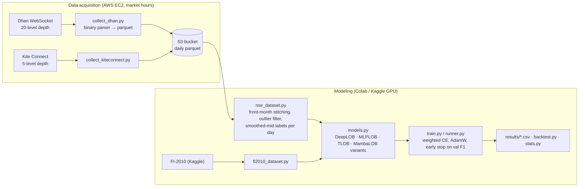

# NSE LOB — Short-Term Index Direction Prediction from Limit Order Book Data


M.Tech (Data Science & AI) capstone, PES University — **Group 5**: Joseph Raj, Sumanth G M, Abhishek Kumar,
Kumara Swamy, Raghav, Saagar (author list as in the project report, `docs/project_report/`).

The project predicts the **next short-term move of the mid-price (Down / Stationary / Up)** from limit order book
(LOB) snapshots, compares **DeepLOB, MLPLOB, TLOB** and **Mamba (selective state-space)** models on the public
**FI-2010** benchmark, and transfers them to **NSE index futures (NIFTY, BANKNIFTY)** collected live from the
Dhan market-data API.

## Problem and motivation

Deep LOB models are almost always evaluated on FI-2010 (Finnish equities, 2010). Whether they transfer to a large,
fast, modern market — Indian index futures — and at what compute cost, is much less studied. The project asks:

1. **Reproduce** DeepLOB / TLOB on FI-2010.
2. **Transfer** them to NSE index futures collected for this project.
3. **Efficiency:** is a Mamba model competitive at lower compute, with linear scaling in sequence length?

## Architecture



## Tech stack

Python · PyTorch · Mamba (`mamba-ssm`, with a pure-PyTorch fallback) · NumPy · pandas · scikit-learn · Optuna ·
PyArrow / s3fs / boto3 · AWS EC2 + S3 · WebSockets · Kaggle and Colab GPUs · pytest · Ruff

## Data

- **FI-2010** — public benchmark (Ntakaris et al., 2018); Kaggle dataset `ulfricirons/fi-2010`, loaded by
  `modeling/fi2010_dataset.py`. Pre-normalised (z-score variant).
- **NSE Dhan 20-level LOB** — collected by this project for NIFTY and BANKNIFTY index futures; 20 valid trading days
  across the May→June 2026 expiry roll, stored as daily parquet in a private S3 bucket. `nse_dataset.py` stitches a
  continuous front-month series and computes labels within each day so nothing crosses a day or contract boundary.
  Data quality analysis: [`docs/data_quality_report.md`](docs/data_quality_report.md). The raw data is not public.

## Results (as recorded in `modeling/results/`)

All numbers are single runs (seed 0 where recorded) on the held-out test days; see the CSVs for every column.

**NSE index futures, weighted F1 on the test split** (`nse_results.csv`, horizon k = 10 events):

| Model | NIFTY | BANKNIFTY | Parameters |
| --- | --- | --- | --- |
| DeepLOB | 0.393 | 0.409 | 191 k |
| MLPLOB | 0.183 | 0.442 | 529 k |
| MambaLOB | 0.389 | — | 99 k |
| Majority-class baseline | 0.183 | 0.182 | — |

**Mamba variants vs TLOB on NIFTY** (`architecture.csv`, all 66 features, labelling scheme A, test macro-F1):

| Model | k = 10 | k = 100 | Parameters |
| --- | --- | --- | --- |
| TLOB | 0.585 | 0.538 | 1.82 M |
| MambaLOB | 0.519 | 0.478 | 70 k |
| ConvMambaLOB | 0.525 | 0.476 | 144 k |
| BiMambaLOB | 0.509 | 0.466 | 135 k |
| BiConvMambaLOB | 0.525 | 0.476 | 209 k |

TLOB is the most accurate; the Mamba variants reach roughly 87–90% of its macro-F1 with 9–26× fewer parameters.
The two tables come from different experiment stages (feature set, labelling and data window differ), so they should
not be compared with each other. The full analysis, including FI-2010 reproduction, is in the project report.

## Setup

```bash
pip install -r requirements.txt
pytest -q                                                 # 10 unit tests, CPU only
cp data_acquisition/.env.example data_acquisition/.env    # only for live collection / S3 access
```

- Local machine: preprocessing, data checks, unit tests.
- **Training runs on a CUDA GPU** (Colab or Kaggle). `mamba-ssm` is CUDA-only; without it MambaLOB falls back to a much
  slower pure-PyTorch implementation.

### Notebooks (Colab or Kaggle)

`notebooks/` holds the experiment drivers (FI-2010 and TLOB reproduction, NSE experiment matrix, feature ablation,
architecture tier, HPO / class imbalance, robustness extras). They detect the host through `modeling/nbenv.py` and
read credentials from Colab/Kaggle secrets: `GH_PAT` (cloning the original private repository), `KAGGLE_USERNAME` /
`KAGGLE_KEY` (FI-2010 on Colab) and `AWS_ACCESS_KEY_ID` / `AWS_SECRET_ACCESS_KEY` (NSE data).
`notebooks/from_kaggle/` contains executed copies with outputs.

### Scripts

```bash
python modeling/run_nse_matrix.py --help     # full NSE experiment matrix
python modeling/run_hpo.py --help            # Optuna hyper-parameter search
python data_acquisition/test_tokens.py       # check Dhan / Kite credentials
```

`data_acquisition/test_*_local.py` and `debug_dhan_packet*.py` are live-API harnesses and packet-format diagnostics
used while building the collector; they are not unit tests.

## Evaluation methodology

- **Labels:** FI-2010-style smoothed mid-price change over horizon k with threshold α (α = 1e-5 for index futures,
  since FI-2010's 0.002 is far too wide at ₹24k–₹55k price levels); computed per trading day.
- **Split:** chronological by trading day (train / validation / test days); windows never straddle a day boundary.
- **Training:** class-weighted cross-entropy, AdamW, early stopping on validation F1.
- **Metrics:** accuracy, macro-F1, weighted-F1, MCC; majority-class, stationary-class and random baselines;
  `stats.py` for seeds / confidence intervals and `backtest.py` for a simple trading check.

## Limitations

- NSE data covers 20 trading days of two instruments; results are single-seed unless noted.
- Model selection details differ between experiment stages (see `docs/work_log.md`).
- The NSE dataset itself cannot be shared.

## Repository structure

```
data_acquisition/   live LOB collectors (Dhan, Kite), token refresh, S3 sync, local harnesses, .env.example
modeling/           datasets, models, training loop, experiment runners, results/
notebooks/          Colab/Kaggle experiment notebooks; from_kaggle/ = executed copies
tests/              unit tests (labels, windowing, model forward passes)
docs/               plans, work log, data-quality report, project report (PDF + LaTeX)
literature/         survey, per-paper notes, proposal (paper PDFs not redistributed)
```

## References

- Z. Zhang, S. Zohren, S. Roberts, "DeepLOB: Deep Convolutional Neural Networks for Limit Order Books,"
  *IEEE Trans. Signal Processing*, 2019.
- A. Ntakaris et al., "Benchmark dataset for mid-price forecasting of limit order book data with machine learning
  methods," *Journal of Forecasting*, 2018.
- L. Berti and G. Kasneci, "TLOB: A Novel Transformer Model with Dual Attention for Stock Price Trend Prediction
  with Limit Order Book Data," 2025.
- A. Gu and T. Dao, "Mamba: Linear-Time Sequence Modeling with Selective State Spaces," 2023.
- Full survey: [`literature/literature_survey.md`](literature/literature_survey.md).
